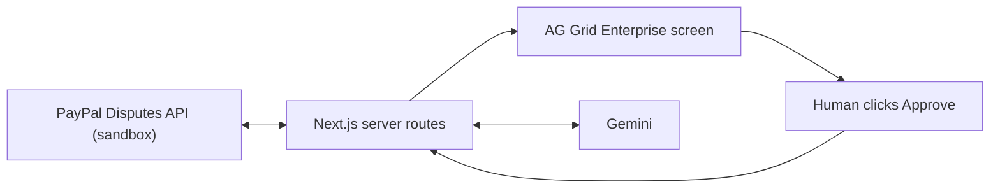
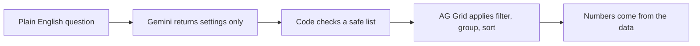

# DisputeShield
 
### The PayPal Payment Integrity Workbench, built on AG Grid Enterprise
 
> **Catch the leak. Prove the case. Recover the money.**
 


-003087)


 
Built for the **"Build What's Next with PayPal and AI"** hackathon.
 
<!-- SCREENSHOT 1 of 3. Save your picture as docs/images/1-grid-master-detail.png
     What to capture: the main grid, grouped, with one row opened to show Master/Detail
     (linked payment, refunds, fee, evidence, with the red problem values visible). -->

 
---
 
## Contents
 
1. [The problem](#the-problem)
2. [The solution](#the-solution)
3. [How it works](#how-it-works)
4. [AG Grid is the product](#ag-grid-is-the-product)
5. [Why it gets messy without AG Grid, even with Excel](#why-it-gets-messy-without-ag-grid-even-with-excel)
6. [PayPal + AI](#paypal--ai)
7. [Impact](#impact)
8. [Try it in 3 minutes (judges)](#try-it-in-3-minutes-judges)
9. [Setup](#setup)
10. [What I added to the starter repo](#what-i-added-to-the-starter-repo)
11. [Honest notes](#honest-notes)
12. [How this maps to the judging criteria](#how-this-maps-to-the-judging-criteria)
---
 
## The problem
 
Sellers lose money on payments in quiet ways:
 
- A dispute deadline passes and the seller never replied.
- A refund is paid twice.
- A fee is charged wrong.
- A settlement arrives short.
Each leak is small. Together they add up. The real trouble is that the facts for one case live in **five different places**: the dispute, the payment, the refunds, the fee and the settlement, plus the evidence PayPal wants. Nobody sees them side by side, so the money is chased late, or never.
 
PayPal gives every dispute a response due date, so a late answer is a lost case.
 
## The solution
 
**DisputeShield turns that scatter into one investigation screen.**
 
- Every dispute is a **row** in an AG Grid Enterprise grid.
- The linked payment, refunds, fee and evidence open **inside the row**.
- **Discrepancy columns** work out how much money leaked and how much can be recovered.
- A **plain-English box** reshapes the grid, so you can ask a new question without building a report.
- A **live panel** talks to the real **PayPal Disputes API** (sandbox). AI drafts the evidence note from PayPal facts. A human approves every action.
It is an investigation engine, not just a table. Find the leak, prove the case, act on it, count the money that came back, all on one screen.
 
---
 
## How it works
 

 
**The AI is on a leash.** In the grid box, the AI never sees your data and never gives numbers:
 

 
### The "Killer demo" button
 
This is a ready-made example question for the AI box. Click it and the grid answers:
 
> "Show me products with the highest refund discrepancies, group them by month, and exclude transactions where the difference is below $20."
 
1. Gemini turns the question into grid settings only (filter, grouping, sort).
2. Code checks the settings against a safe list before the grid uses them.
3. AG Grid reshapes itself.
4. The "In view" line shows the result from the data: **76 of 2,000 disputes, $9,764.90**.
One click shows the whole idea: plain English in, a checked grid out.
 
---
 
## AG Grid is the product
 
If you remove AG Grid, there is no product left. Every step of the investigation happens inside the grid.
 
<!-- SCREENSHOT 2 of 3. Save your picture as docs/images/2-ai-box-killer-demo.png
     What to capture: the AI box after clicking "Killer demo", with the "What the AI did" chips
     and the "In view: 76 of 2,000" line visible. -->

 
| # | AG Grid Enterprise feature | What it does in DisputeShield |
|---|---|---|
| 1 | **Row grouping and aggregation** | Group by month, product or status. Totals for money at stake update live in the group rows. |
| 2 | **Master/Detail** | Click a dispute to see the linked payment, refunds, fee and evidence inside the row. Problem values show in red. Works together with grouping. |
| 3 | **Discrepancy columns** | Fee overcharge, Duplicate refund, Settlement gap, Total to recover, Issues found. The leak is a column you can sort and filter. |
| 4 | **Advanced Filter** | The AI fills the Advanced Filter bar for you. The Builder button lets you edit it by hand. Reset clears it. |
| 5 | **Pivoting + heat map** | One click switches to a month by item heat map of "Total to recover". You see where the money leaks. |
| 6 | **Integrated Charts** | A pivot chart is created from the same grid state, right under the heat map. |
| 7 | **Grouping panel and side bar** | Drag a column to group. Open the side bar to move columns around. |
| 8 | **Grid API driven by plain English** | The AI box changes filters, grouping and sorting through the grid API. Chips show exactly what changed. |
| 9 | **Row jump from proof chips** | In the case brief, click a proof chip and the grid jumps to the row that proves the claim. |
 
<!-- SCREENSHOT 3 of 3. Save your picture as docs/images/3-pivot-heatmap-chart.png
     What to capture: the "Heat map + chart" view, with the month by item heat map
     and the Integrated Chart below it. -->

 
---
 
## Why it gets messy without AG Grid, even with Excel
 
Excel is great for a one-off analysis. DisputeShield is built for the job you repeat every day: **find the leak, prove it, act on it.**
 
| The job | Excel or a plain table | DisputeShield on AG Grid |
|---|---|---|
| See one dispute with its payment, refunds, fee and evidence | Five sheets and lookups, built by hand | **Master/Detail** opens it inside the row |
| Find where the money leaks | Rebuild a pivot table for every question, then chart it | **Pivot heat map and Integrated Chart** in one click |
| Ask a new question | Write filters and formulas yourself | **Plain-English box** drives the grid, with chips that show what it did |
| Keep filters, groups and totals together | Re-do them each time the view changes | They live in **one grid** and stay in sync |
| Act on a dispute | Copy the ID, open PayPal, paste, repeat | **Draft, approve and send** to PayPal from the same screen |
| Know the data is current | The file is stale the moment it is exported | The live panel **reads PayPal's API** |
| Trust an AI claim | Nothing ties a claim to its source | Every claim has a **proof chip** that jumps to the row |
 
---
 
## PayPal + AI
 
### PayPal Disputes API (sandbox, real API calls)
 
| Step | API call | What the app does |
|---|---|---|
| Get a token | `POST /v1/oauth2/token` | Server-side only, keys never reach the browser |
| List disputes | `GET /v1/customer/disputes` | Shows every live sandbox dispute |
| Read details | `GET /v1/customer/disputes/{id}` | Status, stage, amount, due date, transaction ID, the actions PayPal allows, what evidence PayPal wants |
| Message the buyer | `POST /v1/customer/disputes/{id}/send-message` | Only after a human clicks **Approve and send** |
| Send evidence | `POST /v1/customer/disputes/{id}/provide-evidence` | Proof of fulfillment: a tracking number plus a demo PDF |
| Rule the dispute | `POST /v1/customer/disputes/{id}/adjudicate` | A **sandbox-only, simulated** ruling to show the money coming back |
 
The app only shows a button when PayPal says the action is allowed on that dispute. The ruling button appears only when the status is `UNDER_REVIEW` and PayPal offers the adjudicate action.
 
### AI (Gemini), used in three places
 
| Where | What the AI does | The guardrails |
|---|---|---|
| **Ask box** | Turns a question into grid settings | Returns settings only. Code checks them against a safe list. It never sees the data and never gives numbers. |
| **Case brief with proof** | Writes a plain-English brief for a flagged dispute | Each sentence cites fact IDs. Code verifies the text against the facts, and removes what it cannot prove. Proof chips jump to the row. |
| **Draft note (AI)** | Drafts the evidence note for PayPal | It may only use facts PayPal returned (amount, reason, stage, transaction ID, what PayPal asks for, the tracking number). Code checks every dollar amount and blocks claims like "delivered" or "signed". You can edit the note before sending. |
 
**Human in the loop, always.** Every message and every evidence upload asks for a confirmation first.
 
---
 
## Impact
 
**The success metric is money recovered, not money flagged.**
 
| Number | Meaning | Source |
|---|---|---|
| 2,000 | Open disputes in the demo grid | Generated demo data |
| 190 | Expiring in 24 hours | Demo data |
| $26,010.41 | Money at risk in those 24 hours | Demo data |
| 337 | Disputes with at least one issue | Demo data |
| $11,735.87 | Leakage flagged, not yet recovered | Demo data |
| 76 disputes, $9,764.90 | What the Killer demo question finds | Demo data |
 
**A real sandbox run.** A $200 chargeback was created in the PayPal sandbox and escalated. DisputeShield sent the evidence note, the dispute moved to `UNDER_REVIEW`, a simulated seller-favour ruling was applied, and the **Recovered** counter went from **$0.00 to $200.00**. Recovered counts only disputes that PayPal marks resolved in the seller's favour.
 
**Illustrative scenario (a worked example, not a measured result):** a seller with $1,200,000 in yearly sales that loses 1% to these leaks loses $12,000 a year. Finding even part of that is money back.
 
**Who it is for:** small and mid-size merchants, and the finance and support people who handle their disputes and refunds.
 
---
 
## Try it in 3 minutes (judges)
 
1. Open `/disputes`. See the stats cards: open disputes, expiring in 24h, money at risk, disputes with issues, leakage flagged.
2. Click **Killer demo**. Watch the grid reshape, and read the chips and the "In view" line.
3. Expand a row to see **Master/Detail**. Drag a column into the grouping panel.
4. Click **Heat map + chart** for the pivot heat map and the Integrated Chart.
5. Open a **case brief** and click a proof chip. The grid jumps to the proof row.
6. Scroll to **Live PayPal sandbox disputes**. Click **Draft note (AI)**, read the facts list, then **Send evidence**.
7. On a dispute at `UNDER_REVIEW`, click **Simulated ruling: seller wins** and watch **Recovered** change.
---
 
## Setup
 
You need Node.js 20.9 or newer.
 
```bash
git clone https://github.com/YOURNAME/REPONAME.git
cd REPONAME
npm install
```
 
Create your key file (names only are in `env.example`):
 
```bash
# Windows (cmd)
copy env.example .env.local
 
# Mac or Linux
cp env.example .env.local
```
 
Open `.env.local` and fill in:
 
| Key | What it is |
|---|---|
| PayPal sandbox client ID and secret | From developer.paypal.com. Use the key names listed in `env.example`. Sandbox only. |
| `GEMINI_API_KEY` | A Gemini API key |
| `GEMINI_MODEL` | Optional. Defaults to `gemini-3.5-flash-lite` |
| `NEXT_PUBLIC_AG_GRID_LICENSE` | Your AG Grid Enterprise licence key (a free trial is available on ag-grid.com) |
 
Run it:
 
```bash
npm run dev
```
 
Open **http://localhost:3000/disputes**.
 
- The grid, Master/Detail, heat map and charts use the generated demo data.
- The AI box and the case brief need `GEMINI_API_KEY`.
- The live panel needs PayPal sandbox keys and some sandbox disputes.
### Making sandbox disputes for the live panel
 
1. In the PayPal Developer Dashboard, use a US sandbox **Business** account (the seller) and a US **Personal** account (the buyer).
2. As the buyer, pay the business account, then open **Resolution Center, Report a Problem** and file an "item not received" dispute.
3. To reach `UNDER_REVIEW`, escalate it to a claim as the buyer, then send evidence from DisputeShield.
Never commit `.env.local`. It is already in `.gitignore`.
 
---
 
## What I added to the starter repo
 
This project started from the hackathon's PayPal + AG Grid Next.js starter. These are the files I added or changed, and what each one does.
 
| File | What it is | What it does |
|---|---|---|
| `app/(endpoints)/disputes/disputes-data.ts` | Demo data | Generates 2,000 messy, linked rows (disputes, refunds, fees, settlements, duplicates) so the grid shows real scale. Demo data, not real people. |
| `app/(endpoints)/disputes/disputes-grid.tsx` | Main screen | The AG Grid Enterprise grid: grouping, Master/Detail, discrepancy columns, Advanced Filter, pivot heat map, Integrated Chart, the AI box, and the stats cards. |
| `app/(endpoints)/disputes/page.tsx` | Page | The `/disputes` route that shows the screen. |
| `app/(endpoints)/disputes/live-panel.tsx` | Live panel | The PayPal sandbox panel: dispute list, counters, Approve and send, Draft note (AI), Send evidence, Simulated ruling. |
| `app/api/live-disputes/route.ts` | Server route | Talks to the PayPal Disputes API (list, details, message, evidence, adjudicate) and calls Gemini for the evidence draft. Keys stay on the server. |
| `app/api/nl-grid/route.ts` | Server route | Sends the plain-English question to Gemini and returns grid settings. |
| `lib/nl-plan.ts` | Safety layer | The instructions for the AI, the safe-list check, and the Advanced Filter builder. The AI can only ask for settings that pass this check. |
| `app/api/case-brief/route.ts` | Server route | Builds the case brief with proof for one dispute. |
| `lib/case-brief.ts` | Proof checker | Defines the facts, and verifies that every AI sentence is backed by the facts it cites. Also used to check the evidence draft. |
| `package.json`, `package-lock.json` | Packages | Added `ag-grid-enterprise` 36.2.0 and `ag-charts-enterprise` 14.2.0. |
| `env.example` | Key names | Lists the key names you need, with no values. |
| `.gitignore` | Safety | Keeps keys, caches and helper scripts out of GitHub. |
| `docs/images/` | Pictures | The three screenshots used in this README. |
| `LICENSE`, `README.md` | Docs | The MIT licence and this file. |
 
Everything else (the app shell, the other endpoint pages, `lib/paypal.ts`, `lib/ai.ts` and the starter AI route) comes from the hackathon starter. I left the starter AI route alone.
 
---
 
## Honest notes
 
- **The 2,000 rows are generated demo data.** The "flagged" money is demo data, and it is labeled that way on screen.
- **The PayPal part is the sandbox.** The disputes in the live panel are real PayPal sandbox disputes, but no real money moves.
- **The ruling is simulated.** PayPal offers a sandbox-only adjudicate call so developers can test. The button says "Simulated" and is not a real decision.
- **Evidence support is narrow on purpose.** The app sends proof of fulfillment (tracking number plus a demo PDF), which is what PayPal asked for in these cases.
- **AI never acts alone.** It drafts. A human approves.
- **Planned next:** AG Grid's Server-Side Row Model, for much larger live datasets.
---
 
## How this maps to the judging criteria
 
| Criteria | Where to look |
|---|---|
| **Technological implementation** | Real PayPal Disputes API calls (list, details, message, evidence, adjudicate). Nine AG Grid Enterprise features. Three guarded AI uses. |
| **Design** | One screen from "what is leaking" to "money recovered". Clear labels for demo, sandbox and simulated. |
| **Potential impact** | Money recovered is the metric. A real sandbox run took Recovered from $0 to $200. |
| **Innovation** | An AI that changes the grid with settings only, and a proof chip behind every claim. |
| **Presentation** | The demo video and this README. |
 
**Prize tracks:** Best Use of AG Grid, Most Impactful, Best Use of PayPal + AI, Most Creative, Best Demo Delivery.
 
---
 
## License
 
MIT. See [LICENSE](LICENSE). Built on the hackathon's PayPal + AG Grid starter.
